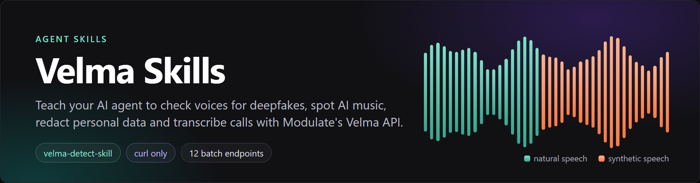

# Velma Skills

[](./LICENSE)
[](https://agentskills.io/specification)
[](https://curl.se)

Agent Skills that give your AI agent [Modulate's Velma](https://docs.modulate.ai) voice AI. Ask it "is this voice fake?", "is this song AI-made?", "remove personal data from this call" or "transcribe this meeting", and it calls the Velma API for you.

A skill is a folder of plain markdown that an agent reads. There is no server to run and nothing to host. The agent follows the instructions and runs `curl`.

Velma is a trademark of Modulate.

## Skills in this repo

| Skill | What it does | Endpoints |
| - | - | - |
| [`velma-detect-skill`](./velma-detect-skill) | Deepfake and AI music detection, PII/PHI redaction, transcription, conversation analysis, emotion, accent, language and audio event detection | 12 batch endpoints, listed below |

More skills can live next to it, one folder each. See [`CONTRIBUTING.md`](./CONTRIBUTING.md).

Prefer typed tools to shell commands? The companion [Velma MCP server](https://github.com/modulate-ai/velma-mcp) exposes the same API as MCP tools.

## What `velma-detect-skill` covers

| Job | Endpoint | Reference |
| - | - | - |
| Is this voice fake, cloned or AI-generated? | `POST /api/velma-2-synthetic-voice-detection-batch` | [Deepfake Detection](https://docs.modulate.ai/api-reference/svd/batch) |
| Is this music AI-made? | `POST /api/velma-2-ai-music-detection-batch` | [AI Music Detection](https://docs.modulate.ai/api-reference/ai-music-detection/batch) |
| Remove personal data (PII/PHI) from a recording | `POST /api/velma-2-pii-phi-redaction-batch` | [PII/PHI Redaction](https://docs.modulate.ai/api-reference/redaction/batch) |
| Transcribe a call, with speakers, emotion, accent | `POST /api/velma-2-stt-batch` | [Transcription](https://docs.modulate.ai/api-reference/stt/batch) |
| Summarise a conversation, find topics and behaviours | `POST /api/velma-2-batch` | [Velma Triage](https://docs.modulate.ai/api-reference/velma/batch) |
| Classify the emotional tone of a recording | `POST /api/velma-2-emotion-batch` | [Emotion Detection](https://docs.modulate.ai/api-reference/emotion/batch) |
| Classify the speaker's accent | `POST /api/velma-2-accent-batch` | [Accent Detection](https://docs.modulate.ai/api-reference/accent/batch) |
| Identify the spoken language | `POST /api/velma-2-language-detection-batch` | [Language Detection](https://docs.modulate.ai/api-reference/language-detection/batch) |
| Find non-speech sound events (applause, dog bark, glass shattering) | `POST /api/velma-2-audio-event-classifier` | [Audio Event Detection](https://docs.modulate.ai/api-reference/audio-event-detection/batch) |
| Tell music from speech, frame by frame | `POST /api/velma-2-music-detection-batch` | [Music Detection](https://docs.modulate.ai/api-reference/music-detection/batch) |
| Fast English transcription, optional medical terms | `POST /api/velma-2-stt-batch-english-vfast` | [English Fast Transcription](https://docs.modulate.ai/api-reference/stt/batch-english-vfast) |
| Fast multilingual transcription | `POST /api/velma-2-stt-batch-multilingual-vfast` | [Multilingual Fast Transcription](https://docs.modulate.ai/api-reference/stt/batch-multilingual-vfast) |

Streaming (WebSocket) endpoints are not covered. A working streaming example is in [velma-browser-streaming-example](https://github.com/modulate-ai/velma-browser-streaming-example).

## Quickstart

1. Get a key at https://platform.modulate.ai/signup-request. New accounts get free credits. Then export it, and never commit it:

```bash
export VELMA_API_KEY=your-key-here
```

2. Install the skill into your agent's skills folder:

```bash
npx skills add modulate-ai/velma-skills --skill velma-detect-skill
```

Or copy the folder by hand, for example for Claude Code: `cp -R velma-detect-skill .claude/skills/`. Other agents are listed in the [skill README](./velma-detect-skill/README.md).

3. Ask your agent, for example:
   - "Is `fixtures/synthetic-1.wav` a deepfake?"
   - "Redact the names and phone numbers from `fixtures/pii-speech.wav`."
   - "Transcribe `call.wav` with speaker labels and emotion."

## How it works

```mermaid
%%{init: {"flowchart": {"nodeSpacing": 24, "rankSpacing": 36, "padding": 6, "wrappingWidth": 260, "htmlLabels": true}, "themeVariables": {"fontSize": "13px"}}}%%
flowchart LR
    classDef agent fill:#dbeafe,stroke:#2563eb,color:#0f172a
    classDef local fill:#e5e7eb,stroke:#4b5563,color:#0f172a
    classDef velma fill:#ede9fe,stroke:#7c3aed,color:#0f172a

    A["<b>Your agent</b><br/>asked about an audio file"]:::agent
    S["<b>SKILL.md</b><br/>picks the endpoint, loads<br/>one reference file"]:::local
    C["<b>curl</b><br/>runs on your machine"]:::local
    V["<b>Velma batch API</b><br/>platform.modulate.ai"]:::velma
    R["<b>Result</b><br/>verdicts, transcript,<br/>redacted MP3"]:::agent

    A -->|"matches the skill description"| S
    S --> C
    C -->|"POST upload_file<br/>X-API-Key"| V
    V --> R
```



The agent loads `SKILL.md` only when the request matches the skill description, and reads a reference file only for the endpoint it needs. The API key stays in your shell environment and is sent only to Modulate in the `X-API-Key` header. Redaction replies are multipart, so a small script, `scripts/split_redaction.py`, splits them into `metadata.json` and `redacted.mp3`.

## Results on the bundled clips

Run on 2026-11-02 against the live API.

| Clip | Result | Confidence |
| - | - | - |
| `fixtures/synthetic-1.wav` (text-to-speech) | 3 of 3 deepfake frames synthetic | 0.969 to 0.975 |
| `fixtures/real-2.wav` (human reading) | 3 of 3 deepfake frames non-synthetic | 0.912 to 0.922 |
| `fixtures/pii-speech.wav` (made-up name, phone, date of birth) | All three spans tagged and silenced | n/a |

Results are probability signals, not proof. A few short studio-style clips are not a benchmark. Sources and licences for every clip are in [`fixtures/SOURCES.md`](./fixtures/SOURCES.md).

## Repo layout

```text
.
  velma-detect-skill/  SKILL.md, references/, scripts/, evals/ (trigger prompts)
  fixtures/            shared test clips and their sources
  docs/images/         banner
  .github/workflows/   skill validation
```

## Develop

```bash
pip install "git+https://github.com/agentskills/agentskills#subdirectory=skills-ref"
skills-ref validate ./velma-detect-skill        # skill format check
```

To check that the skill loads for the right prompts, see `velma-detect-skill/evals/`. See [`CHANGELOG.md`](./CHANGELOG.md) for what is in each release.

## Privacy and safety

- Every call uploads audio to Modulate's API. Per Modulate's [FAQ](https://docs.modulate.ai/faq), self-service accounts are enrolled in model improvement unless they opt out with Modulate. Do not send audio you may not share.
- The API key lives only in your environment or a gitignored `.env`. The skill tells the agent never to print it.
- Spot-check redacted output before sharing it.

## Links

- [Velma docs](https://docs.modulate.ai), [authentication and limits](https://docs.modulate.ai/guides/authentication), [troubleshooting](https://docs.modulate.ai/guides/troubleshooting), [FAQ](https://docs.modulate.ai/faq), [support](https://docs.modulate.ai/support)
- [Which API should I use?](https://docs.modulate.ai/guides/which-api), [pricing](https://www.modulate.ai/api-pricing), [Deepfake Detection overview](https://docs.modulate.ai/get-started/deepfake)
- [Agent Skills specification](https://agentskills.io/specification)

## Licence

MIT. Copyright (c) 2026 Modulate AI. See [`LICENSE`](./LICENSE).
